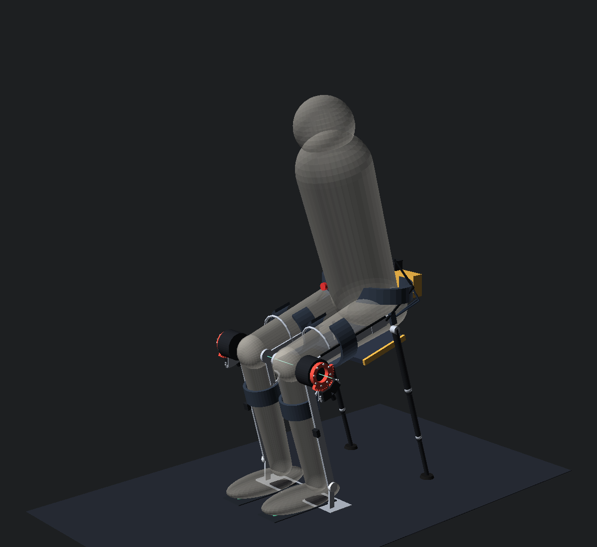
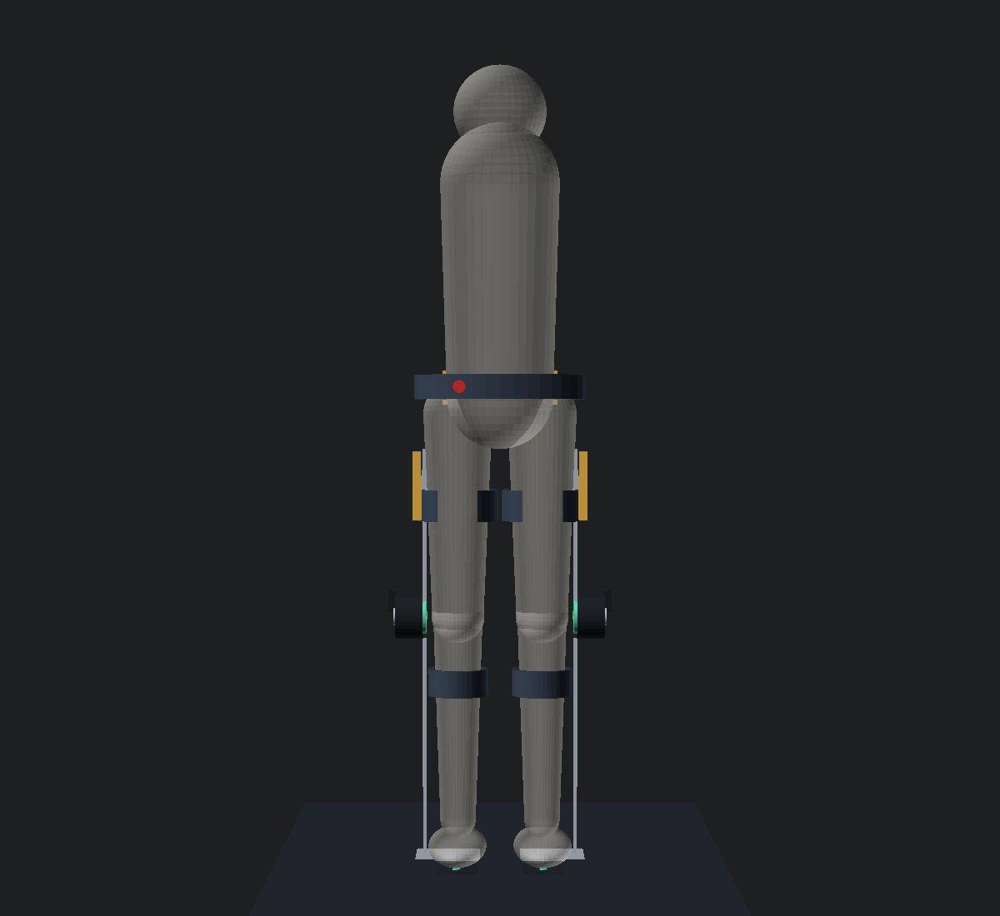
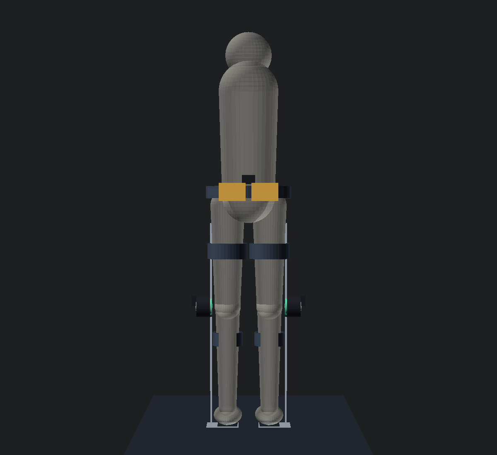
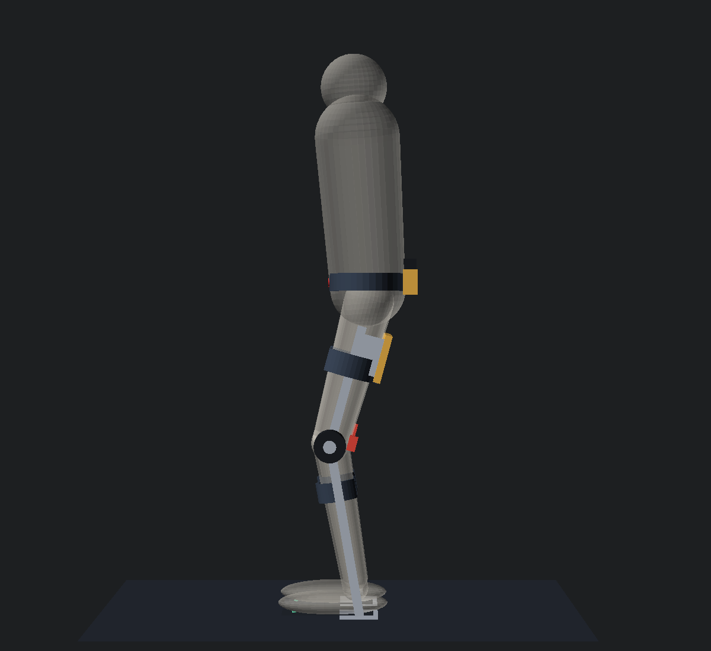
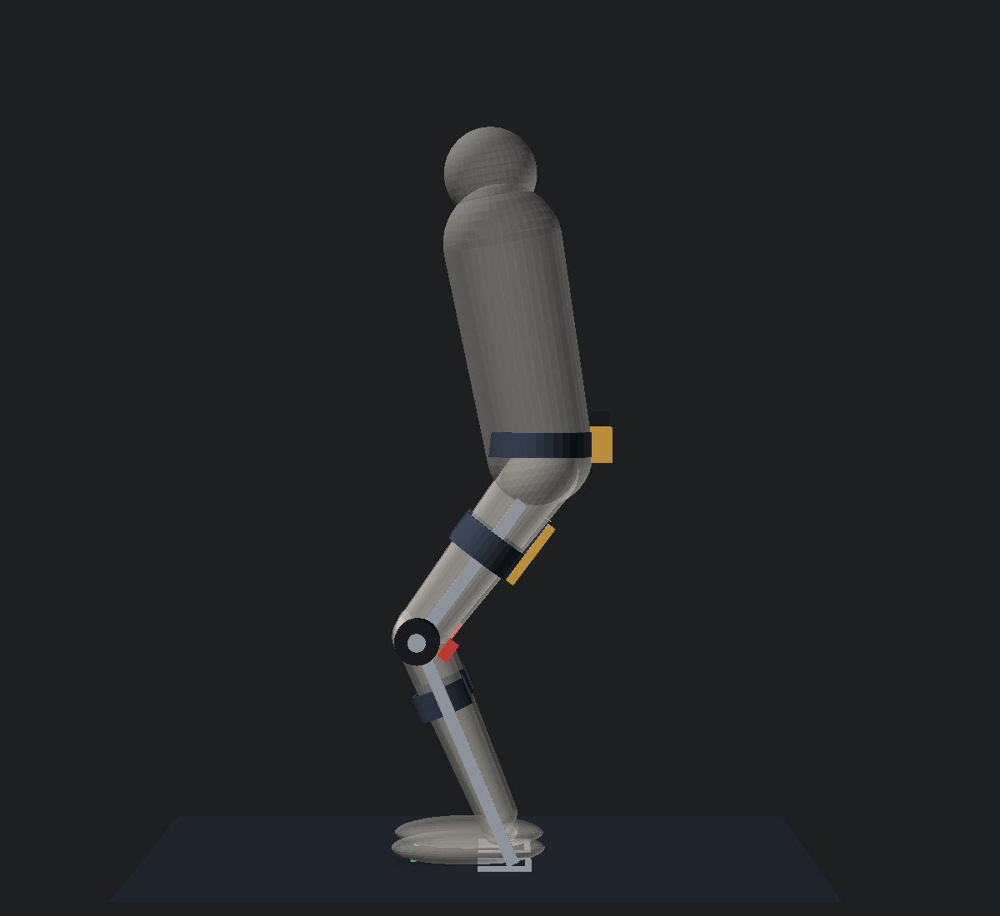
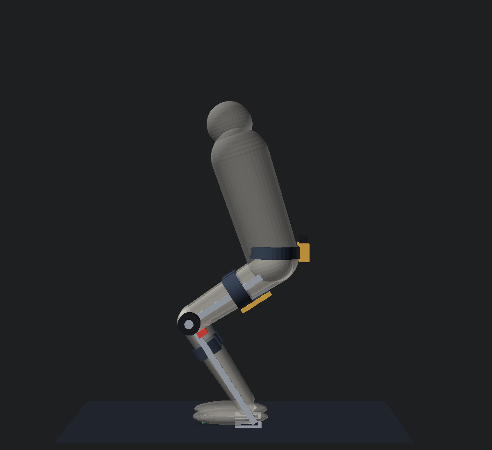
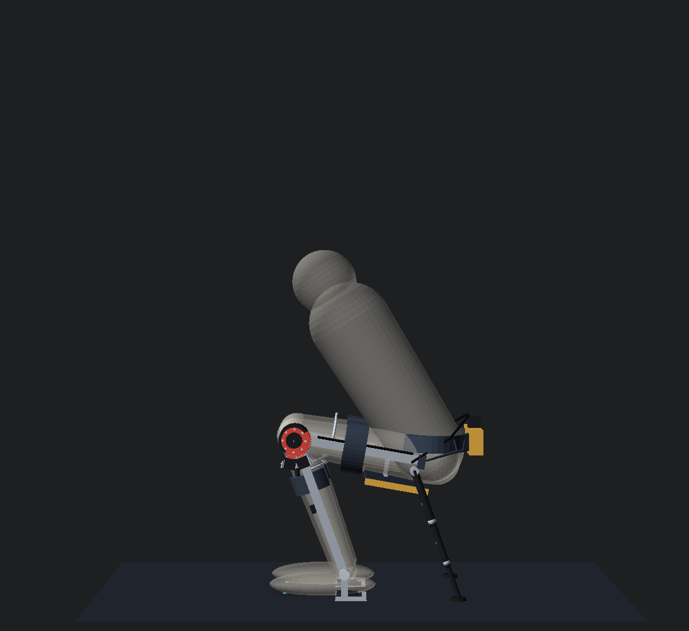
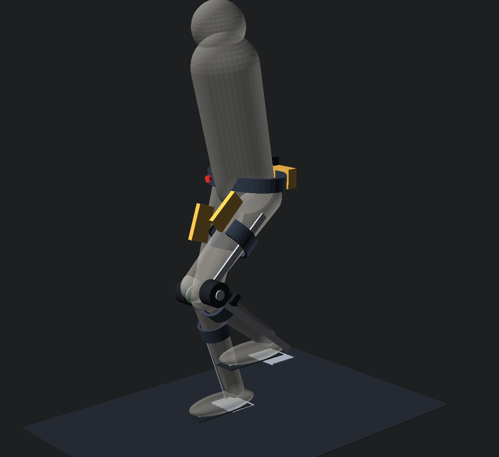
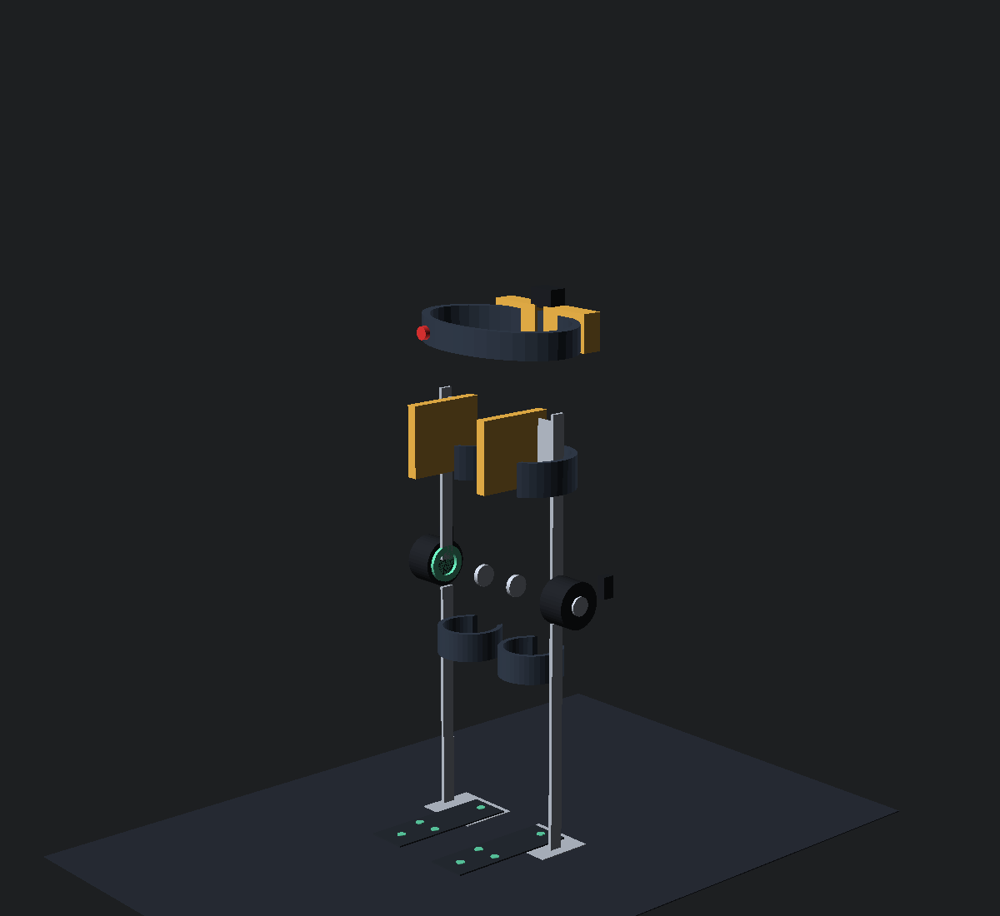
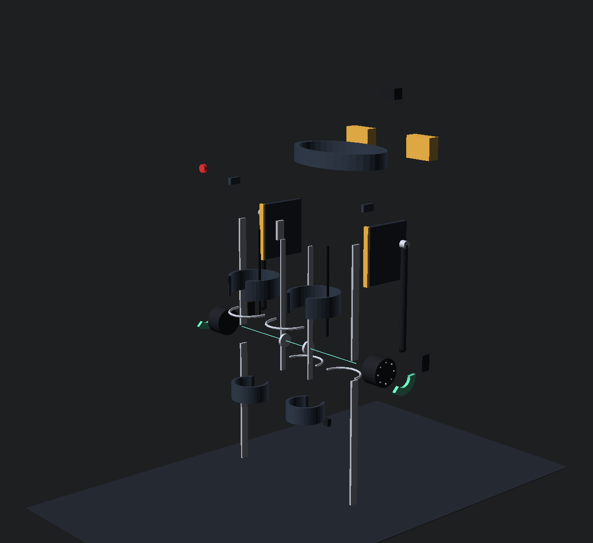

# Sitka: Open Powered Knee Exoskeleton with a Seat Built In
*Motorized knees that help you walk, hike and run, then lock at the angle you pick so you can sit anywhere. Designed in America, given away to everyone.*

### ▶ [Open the live 3D viewer](https://nicedreamzapp.github.io/sitka/run_sit_exo_viewer.html) · [watch it assemble](https://nicedreamzapp.github.io/sitka/run_sit_exo_viewer.html?anim=assembly) · [watch it walk, hike, run and sit](https://nicedreamzapp.github.io/sitka/run_sit_exo_viewer.html?anim=body)
*Runs in any browser, no install. Click any part for its price, mass and why it's there.*

> **Mission:** This project is about freedom of movement. Go farther on your own legs, and rest wherever you are: on a trail with no bench, at a shop bench all day, in a line that never ends. The machine works for the person wearing it, quietly, and never against anyone. We build it to give people more say in how far they can go and when they can stop.

| | |
|---|---|
|  |  |

## What this is
A fully open-source design for a **powered lower-limb exoskeleton** that does two jobs no single product does today:

1. **Assist.** A quasi-direct-drive robot-joint motor at each knee adds torque while you walk, climb, run and come back down.
2. **Seat.** Stop, tap once, and the motors bend your knees to one of four angles. A one-way steel ratchet at each knee catches the bend, pads fold down under your thighs, a short rear leg swings down behind each thigh, and you sit on a three-point stand: heel, toes and rear foot.

**As of October 2026 no product combines powered running or hiking assist with a lockable seat.** Hypershell, Dnsys, Ascentiz and Arc'teryx MO/GO assist but cannot seat you. Noonee's Chairless Chair and Archelis seat you but have no motor. See `RESEARCH_REPORT_2026-10-21.md`.

Everything is open: the CAD, the 3D viewer, the physics, the parts list with prices, and the research behind every decision. Where someone already gave their work away (NAU's OpenExo above all), we build on it and give ours away too.

**Every number below is one we can defend, including the ones that hurt.** Each input is tagged in `params.mjs` as sourced, computed, or our estimate.

## The four seat angles
Numbers for a **130 kg, 1.87 m man** (US 95th percentile for both, NHANES), wearing the exo, rear legs down. `node seat_torque_model.mjs`

| | **Perch** | **Half-sit** | **Chair** | **Deep squat** |
|---|---|---|---|---|
| Knee angle / shin lean | 25° / 10° | 60° / 15° | 90° / 15° | 120° / 20° |
| |  |  |  |  |
| Seat height (hip) | 0.98 m | 0.85 m | 0.64 m | 0.43 m |
| Rear leg | stowed | 0.84 m | 0.65 m | 0.46 m |
| Load down the rear leg | 0% | 28% | 40% | 30% |
| Knee lock, per knee | 52 Nm | 78 Nm | **79 Nm** | 94 Nm |
| Knee lock **without** the rear leg | 52 Nm | 145 Nm | 190 Nm | 168 Nm |
| Tip-over margin back / forward | 0.05 / 0.21 m | 0.29 / 0.31 m | **0.28 / 0.38 m** | 0.26 / 0.31 m |
| Tilt to tip back / sideways | 3° / 11° | 18° / 12° | 21° / 14° | 25° / 19° |
| Use | lean-assist in lines (your own balance) | bar stool | full seat | work near the ground |

**Without the rear leg only Perch is allowed:** in the other three the whole-body centre of mass lands 4–11 cm *behind* the heel, and you go over backward. The ratchet and the frame are still sized for a **507 Nm fallback** (rear leg slips, thigh level, all weight on one leg, ×1.5).

| Running stride | Exo only | Exploded |
|---|---|---|
|  |  |  |

## Current design (prototype one, P1)
- **Knee actuators:** CubeMars **AK10-9 V2.0** at each knee: 9:1 quasi-direct drive, 18 Nm rated, 48 Nm peak, 0.8 Nm backdrive, CAN, $698.90. It keeps up with a running knee (rated 205 rpm = 21.5 rad/s at 24 V, more than twice the ~8.7 rad/s a running knee reaches in swing), and it adds only ~2% to the inertia your shank already swings.
- **Seat lock: a one-way ratchet with two pawls.** A 40-tooth 17-4PH sector at r = 50 mm, bolted to the AK10-9 output flange with 8 × M4 12.9 screws (1.76 kN shear each at 507 Nm, SF 3.7), and two 3-tooth pawls offset half a pitch (4.5°) in a housing on the actuator case's outboard face, so you sag at most 2.7 cm at the pad (3.6 cm at the hip) onto the next tooth. It **blocks bending and always lets the knee straighten**: you stand up with no release step, power on or off, and the pawls click over the teeth on the way up (that is correct). A bistable solenoid lifts the pawls only when they carry no load; a sprung detent stops its 4 N from ever dropping a pawl mid-stride. Each pawl has a hall sensor and a strain-gauge load sensor. Flank angles are matched with crown relief: contact 134 MPa (2 teeth) / 269 MPa (1 tooth); root bending 359 / **717 MPa (SF 1.6 on one tooth, so a proof test is required)**.
- **Why not a stronger motor?** A 64:1 AK80-64 has 120 Nm peak, and at 23 rpm it runs at 28% of running swing speed, so it would fight a runner. A motor holding even 48 Nm burns about 92 W per knee as heat. The ratchet holds for 0 W.
- **Rear legs.** Each thigh carries a 3-section telescoping carbon tube with a uniform 1.5 mm wall, Ø24/20/16 mm, hinged at the top of the thigh rail: one-way lock (extends freely, locks in compression), torsion spring to retract, 0.35 m stowed, 0.84 m in half-sit. It buckles at **3.2 kN** at that length (stepped-column solve; a stock 16/14/12 trekking pole would give only 0.87 kN). Nominal load 196–284 N; design 1 kN. The foot is a 360° pivoting rubber cane tip with a flip-down ice/trail spike.
- **Frame:** 7075-T6 lateral uprights, 8 × 28 mm, sized for the 507 Nm fallback, with the knee axis at the lateral epicondyle on a ±10 mm slot. A 6 × 20 mm 7075 medial bar on each leg runs on a single-axis medial hinge coaxial with the actuator, tied to the lateral side by an anterior thigh bridge and a posterior shank bridge, so the knee is a closed box and not a cantilever. A **free ankle pivot** (+35° dorsiflexion / −45° plantarflexion stops) at the lateral malleolus carries a heel stirrup with a heel pad right below it and a strap round the shoe's heel counter. Seat pads are 200 × 180 mm on a lateral hinge plus a medial arm.
- **Belt to legs: straps, no rigid hip joint.** Two straps per side run from the belt to a yoke at the top of each thigh rail so the leg units can't slide down. There is no rigid hip joint because the seat loads close inside each leg (heel, toes, rear foot) and never need the belt, and a rigid joint that is not exactly on your hip's three axes fights every step.
- **Wiring:** one braided sleeve per side, 24 V + CAN, with a service loop at the rail top for 120° of hip flexion. The pawl solenoids run on their own always-live 12 V rail; **the E-stop cuts the motors only**, so the ratchet keeps working.
- **Brain:** Teensy 4.1 + CAN, the same MCU family and motor bus as NAU's OpenExo, so their firmware is our starting point. BNO085 IMUs at the pelvis and both shanks. Four FSRs per foot. An ESP32-S3 links to the phone.
- **Power:** two quick-swap **6S1P Molicel P45B packs, 97 Wh each** (194 Wh total). Each is under the FAA's 100 Wh carry-on line, so it flies with you.
- **Features:**
  - **Seat offer:** it detects that you've stopped, buzzes your thighs, and one tap sits you down.
  - **Downhill braking:** the motors brake your knees on descents and stairs.
  - **Fall catch:** on a stumble, both knees go to peak torque and heavy damping.
  - **Place memory:** it suggests the angle you picked last time at this spot.

### Seat lock safety rule
**The motor cannot hold you in any seat:** the targets need 78–94 Nm per knee with the rear leg and 145–190 Nm without, against 48 Nm peak. So:
1. **Drop:** your quads hold you, with motor braking. Pawls held up.
2. **Seat:** at the target the pawls are released and you **lower until seated**. The motor lets go only when the hall sensor says engaged *and* the load sensor carries load.
3. **Emergency catch:** an unexpected knee bend drops the pawls only below 60°/s. **The descent is otherwise unprotected.** Above that speed the catch is not attempted.
4. **Stand:** straightening is always free; the clicks are normal. Below 20° and straightening, the pawls lift for walking.
5. **Depth change:** the rear pole is locked in compression and cannot shorten, so to go deeper you stand up (knee under 20°) and sit again.
6. **Perch is never hands-free.** The firmware, app and manual must never call it that.

Pawls never drop at a walk or a run, and anything deeper than Perch needs both rear feet on the ground.

## How it holds you up when you sit
See the side-view force diagram: **[sit_diagram.html](https://nicedreamzapp.github.io/sitka/sit_diagram.html)**.

Each leg unit stands on three points: your heel, the ball of your foot, and the rear foot about 0.30–0.39 m behind your heel. In chair mode, for a 130 kg man:
- **40% of the load goes down the rear leg** (284 N axial per leg). It is a strut, pinned at both ends, so it only ever pushes along its length. At 17° from vertical it needs a friction coefficient of 0.30 at the foot: half of rubber on dry concrete (0.6–0.85), and inside wet concrete (0.45–0.75) and wet-rated tile (≥0.42).
- **60% goes through the locked knee** (79 Nm per ratchet), down the shin rail, through the free ankle pivot, into the heel pad and your shoe.
- The whole-system centre of mass sits **11 cm behind your heel**, inside a support area that runs from the rear feet (0.39 m behind the heel) to your toes. That leaves 0.28 m of margin backward and 0.38 m forward: you would have to tilt 21° back to go over.
- **Sideways:** the rear feet are 0.34 m apart and the shoes about 0.40 m across their outer edges, which gives about 0.19 m each side, or a 14° tilt.
- Your ankle muscles relax: the exo's ankle pivot is free, and the shin leans only 15°, inside the ~20° your ankle comfortably bends under load.

## Honest status: what does not close yet
- **v1 tipped over backward, and the owner caught it.** The first design put the pad's centre of pressure over the heel, which is the *back edge* of the foot. Re-run in this model, its centre of mass sat ~5 cm in front of the heel edge: a 4° lean back, a pack shift or a slope and you go over. It also asked for 32.9° of shin lean, well past the ~20° an ankle comfortably holds under load, and "the feet take the rest" quietly meant leg muscles. Two more v1 errors: its solenoid could not have pulled a loaded pawl out (~2 kN of tooth friction), and its 48 Nm motor could not unload a 142 Nm hold to let it. v2 fixes all of it with the rear legs, the free ankle, and the one-way ratchet.
- **Mass got worse, and it is the live risk.** v2 is **3.85 kg per leg and 9.21 kg worn** (v1: 2.91 / 7.2). The plan target was ~3.55 kg per leg. The dual-pawl ratchet, housing and sector bolts added 0.13 kg per leg after the re-audit. A −190 g path exists on paper (to ~3.66) (count only the parts of the donor brace we keep, −120 g; book a third of the harness to the belt, −50 g; slimmer medial bars, −20 g), but none of it is weighed, so **3.85 kg is the number until the scale says otherwise**; the old ~3.55 target is out of reach without a lighter actuator or frame. That is about five times the Dnsys Z1's ~0.68 kg per leg, an 11.4 kg waist-equivalent load. **The assist has to beat its own mass before this helps anyone, and nothing here proves it does yet.** `node mass_budget.mjs`
- **Rear foot on wet floors: there is a limit.** The legs are angled so the foot needs a friction coefficient of 0.30. Rubber gives 0.6–0.85 on dry concrete and 0.45–0.75 on wet concrete (Engineering ToolBox), and wet-rated interior tile tests at 0.42 or more (ANSI A326.3). One source puts rubber on wet concrete as low as 0.30, which is zero margin. **Wet polished stone, unrated wet tile, mud and ice are not safe for the rubber foot.** Flip down the spike outdoors, or use Perch. The carbide-spike option is not sourced yet (the listed ice tips are steel).
- **Perch is a lean-assist, not hands-free sitting.** Without the rear leg the centre of mass sits about over your ankle, 5 cm in front of the heel edge (a 3° tilt). The lock takes the knee bend, but your own calves keep you balanced, as when standing. Lean on something, or put the rear legs down and use Half-sit.
- **Rear-leg stiffness is assumed, not measured.** The 3.2 kN buckling load uses E = 70 GPa for roll-wrapped carbon and a ~$10 tube from an unverified seller. Every pole gets proof-tested to 1 kN at full length at M1.
- **Running assist is real but modest.** 48 Nm peak is ~18% of a median runner's midstance knee moment and ~12% for a 130 kg runner. No knee exo we found has shown a metabolic saving in running. MIT's clutch-spring knee exo did not.
- **Runtime depends on a strategy we haven't tested.** Conservative running is **~2.8 h (~36 km) at 58 W**. Push-only assist is ~4 h. Hiking uphill at 25 Nm assist is **~4.2 h**. Sitting costs 5 W. On paper, braking assist while running could stretch runtime a lot; we do not claim that until a bench shows it. `node energy_model.mjs`
- **Regen is a few watts, not a charger.** The best net downhill regen is **~3.7 W**. Downhill mode earns its place by taking load off your quads.
- **Fall catch buys time; it does not catch you.** A hard single-leg catch is ~270–410 Nm of knee moment. Two motors at 48 Nm give 12–18% of that.
- **The ratchet only just clears on one tooth.** If only one of the two engaged teeth carries the 507 Nm fallback, root bending is 717 MPa (SF 1.6 on a handbook yield we still have to verify). Matched-flank contact is 134–269 MPa. Every ratchet is proof-tested at M1. The 72 mm bolt circle is a guess until checked on the CubeMars drawing.
- **Inputs flagged EST in `params.mjs`:** pad position (75% of thigh), rear-hinge position, carbon modulus and density, friction on wood and dry tile, stance width, trunk lean per mode, running cadence and contact time, drive efficiencies, idle draw, and **44% of the parts cost** (mostly machining and the custom ratchet). The bench replaces all of these.

## What it costs, honestly
The parts list is not the project. Both numbers matter. `node project_cost.mjs`

| | |
|---|---|
| **P1, one exo, parts only** | **$4,416** (`bom.mjs`; $1,937 of it is estimate, not quote) |
| P1 worn and tested, all in | **~$7,126** |

The gap is what a parts list quietly omits:
- a knee test stand with a load cell
- a bench supply
- a spare actuator (one will get cooked in tuning)
- a spare lock set
- an overhead safety harness for the first sit tests
- shipping and tax
- a $500 breakage allowance

Labour is $0; it assumes you build it yourself.

### You do not build the whole exo first
| | | |
|---|---|---|
| **M1** | one knee + ratchet on a dummy-leg stand, plus a rear-leg pole buckling test | **~$1,697** |
| **M2** | one leg, worn: walking and stairs, no seat | ~$938 |
| **M3** | both legs + belt: running and hiking assist | ~$2,208 |
| **M4** | rear legs + seat modes, under an overhead harness first | ~$680 |

**M1 answers the two questions that decide the project** before anything is strapped to a person: does the 3-tooth ratchet hold 507 Nm and drop in cleanly at every tooth, does the stock pole carry 1 kN, and does the motor stay cool through a simulated hour of hiking?

## Safety comes before anyone wears it
**No person sits in it until the lock has held its design load on the bench, thousands of times.** The ladder is not optional:
1. **M0:** close the mass and torque budgets on paper (this repo).
2. **M1:** one knee on a stand. Proof-load the pawl to 507 Nm at every detent; cycle it 10,000×. Thermal test the motor. **Vendor numbers die on the stand.**
3. **M2:** one leg worn, walking and stairs only, with motor torque capped low. E-stop in reach.
4. **M3:** both legs: hiking, then running, on a treadmill with a fall harness.
5. **M4:** seat modes under an overhead harness, then free.

Hard rules in firmware and hardware:
- The motor lets go only after the pawls are seated (hall) and loaded (strain gauge), and deeper than Perch only with both rear feet on the ground.
- With no rear leg on the ground, only Perch may lock: the other three modes tip backward without it.
- The ratchet blocks bending only. Straightening is always free, so you can always stand up, power or no power.
- The pawl lifts only when its load sensor reads ~0; nothing ever tries to drag out a loaded pawl.
- The E-stop cuts the motors only. The solenoids sit on an always-live 12 V rail so the ratchet keeps working.
- Motor torque is software-limited per stage.
- At M1, proof-load the ratchet to 507 Nm at every tooth and the rear pole to 1 kN at full length before anyone sits.
- On a wet or icy surface the rubber foot is not trusted: spike down, or Perch only.
- Perch is lean-assist only; the firmware, app and manual never call it hands-free.
- The descent into a seat is protected only by the velocity-gated catch (< 60°/s); the manual says so.
- Nothing ships with a seat mode until M4 passes, starting on flat dry ground.

This is experimental assistive hardware, not a medical device. Anyone with a knee condition should talk to a clinician before wearing anything like it.

## Built on (and credited)
- **[NAU OpenExo](https://theopenexo.nau.edu/)** ([naubiomech/OpenExo](https://github.com/naubiomech/OpenExo), CERN-OHL-P-2.0 hardware / LGPL-3.0 software). Our electronics and firmware starting point: Teensy plus AK-series motors over CAN.
- **[Madeeha-Fayyaz8621/ChairlessChair-IoT](https://github.com/Madeeha-Fayyaz8621/ChairlessChair-IoT)** (MIT). Open wearable-chair firmware with FSR posture detection.
- **[eliotk/OpenExo](https://github.com/eliotk/OpenExo)** (MIT). An early Arduino exo with an FSR and a brake.
- **Inspiration only** (no licence, so we cannot reuse their files):
  - [srisura1010's IMU-gait knee exo](https://github.com/srisura1010/Motor-Actuated-Knee-Exoskeleton-Using-IMU-Based-Gait-Detection)
  - [MaGabRam's QDD knee actuator](https://github.com/MaGabRam/qdd-knee-exoskeleton)
- **Noonee Chairless Chair** and **Archelis** proved a wearable seat works. **Hypershell** and **Dnsys** proved people will wear powered legs on a trail. See `CREDITS.md`.

## Repository map
| File | What it is |
|------|-----------|
| `index.html` | Redirects the GitHub Pages site to the viewer |
| `run_sit_exo_viewer.html` | **The live CAD** ([open it](https://nicedreamzapp.github.io/sitka/run_sit_exo_viewer.html)). Orbit, switch modes, explode, click any part for price and spec. **▶ Assembly** builds it in 7 steps; **▶ On body** walks, hikes, runs, stops, offers a seat, sits in all four angles and stands up, with motor, lock, pad and foot-sensor state live |
| `run_sit_exo_assembly.html` / `run_sit_exo_onbody.html` | Open the viewer straight into either animation |
| `run_sit_exo.scad` | Parametric OpenSCAD model; `mode` = stand / perch / halfsit / chair / squat / run |
| `render_all.sh` → `renders/*.png` | Renders every view and mode with the OpenSCAD CLI |
| `params.mjs` | Every input, each tagged `[SRC n]`, `[CALC]` or `[EST]` |
| `seat_torque_model.mjs` | Seat tripod statics per angle (with and without the rear leg), tipping margins front/back/side, ratchet tooth stress, rear-leg buckling, upright sizing |
| `sit_diagram.html` | Side-view force diagram of how the seat holds you up ([open it](https://nicedreamzapp.github.io/sitka/sit_diagram.html)) |
| `gait_assist_model.mjs` | Assist share per activity, speed check, inertia, fall catch |
| `energy_model.mjs` | Runtime for walk, hike, run and sit; regen; a day-hike budget |
| `mass_budget.mjs` | Mass per leg and belt, and its metabolic weighting |
| `bom.mjs` → `PARTS_LIST_BOM.md` | Bill of materials with prices, links and sources (one source of truth) |
| `project_cost.mjs` | All-in cost and the M1–M4 money ladder |
| `run_all.mjs` → `MODEL_OUTPUT.txt` | Every model's output in one file |
| `concept.html` | One-page concept sketch, drawn from the same geometry |
| `RESEARCH_REPORT_2026-10-21.md` | Sources, prior art, licences, what we could not find |

**Run the numbers:** `node run_all.mjs` (Node 18+, no dependencies).
**View the CAD:** [live viewer](https://nicedreamzapp.github.io/sitka/run_sit_exo_viewer.html), or open `run_sit_exo_viewer.html` locally in any browser; no install, no account. Options: `?anim=assembly|body` · `?mode=chair` · `?view=side` · `?labels=1` · `?shot=1` (download a PNG).
**Re-render:** `bash render_all.sh` (OpenSCAD 2021.01+).

## How to contribute
Anyone may use, study, modify and share this design. Improvements that keep it open are welcome, especially:
- **Mass:** lighter uprights, a lighter stirrup, a lighter lock.
- **The lock:** contact and bending analysis, then a test rig.
- **Controllers:** gait-phase control ported from OpenExo.
- **Real data:** metabolic test data of any kind.

**Test data is as valuable as design changes.** No weapons work. See `CONTRIBUTING.md`.

## License
Open hardware and open source, chosen so it can **never be locked up**:
- **Hardware / CAD:** [CERN-OHL-S-2.0](https://ohwr.org/cern_ohl_s_v2.txt) (strongly reciprocal; derivatives stay open)
- **Software:** [GPL-3.0](https://www.gnu.org/licenses/gpl-3.0.txt)
- **Documentation / research:** [CC-BY-SA-4.0](https://creativecommons.org/licenses/by-sa/4.0/)

You are free to build one. You are not free to take it private.
